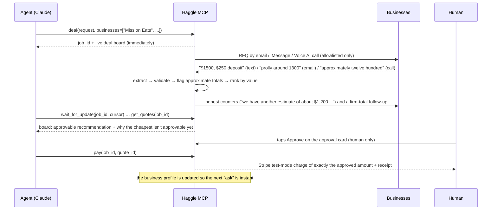

# Haggle

**Haggle turns any business's email, phone and texts into an API that AI agents can use.**

Haggle is an [MCP](https://modelcontextprotocol.io) server and MCP App. An AI agent (Claude, ChatGPT, Claude Code or any MCP client) tells it what it needs to buy. Haggle then:

- finds real businesses;
- contacts each one on the channel it actually uses: email, a phone call placed by a voice agent, iMessage/RCS or agent-to-agent (A2A);
- reads their messy replies and call transcripts, follows up and negotiates honestly;
- recommends the best value;
- gets a human's approval and pays, in Stripe test mode.

Every conversation teaches Haggle about that business, so the next agent can get an instant estimate instead of waiting hours.

The same server works headlessly for agents and renders live views (a deal board, an approval card, estimates, business profiles) inside Claude and ChatGPT.

Built for YC's *Make Something Agents Want* hackathon by Yash and Aarnav. 2nd place - Inkbox Track. 3rd place - Stripe Track
Stack: Manufact, Inkbox, Stripe, Supabase.

---

## Contents

1. [The problem](#1-the-problem)
2. [Our solution](#2-our-solution)
3. [What a deal looks like](#3-what-a-deal-looks-like)
4. [Core features, and the complexity behind each](#4-core-features-and-the-complexity-behind-each)
5. [MCP tools](#5-mcp-tools)
6. [Architecture](#6-architecture)
7. [Running it on your own machine](#7-running-it-on-your-own-machine)
8. [Configuration reference](#8-configuration-reference)
9. [Testing and verification](#9-testing-and-verification)
10. [Deployment](#10-deployment)
11. [Safety model](#11-safety-model)
12. [Repository layout](#12-repository-layout)
13. [Status and known limitations](#13-status-and-known-limitations)
14. [Further documentation](#14-further-documentation)

---

## 1. The problem

Agents can reason, browse and even pay, but most of the economy does not have an API. A caterer, a plumber or a print shop does business by email, phone calls and text messages. An agent trying to buy from them hits six walls:

| Wall | Why it stops an agent |
|---|---|
| **It can't wait** | A business replies hours later, long after the agent's session has ended. |
| **It has no identity** | It has no email address, phone number or iMessage handle to reach anyone from. |
| **It can't call** | Many small businesses only quote over the phone. |
| **Replies are messy** | "prolly around 1300 total bucks", PDFs, voicemail and phone menus, half-answered questions, a deposit mentioned in passing. |
| **Negotiating is risky** | An LLM left to haggle will happily invent a competing offer, or follow a payment link a "business" sent. |
| **Money needs a human** | Paying an unverified party, an amount that changed, or anything a human didn't approve is unacceptable. |

Every agent that wants to buy from the real world has to solve all six, every time, from scratch.

## 2. Our solution

Haggle solves them once, behind a small set of MCP tools designed for agents: few calls, compact structured output, a `next` hint on every response, and errors that say how to fix them.

| Wall | What Haggle does |
|---|---|
| Can't wait | `deal` returns a `job_id` immediately. The job runs in the background (webhooks plus a background tick) and outlives the agent's session; agents long-poll `wait_for_update` with a cursor. |
| No identity | Haggle has a real **Inkbox** identity: a mailbox (one per job), a phone line, iMessage and an A2A agent card. |
| Can't call | **Inkbox Voice AI** places the call with a brief that says it is an AI assistant requesting a quote, and returns the transcript and outcome. |
| Messy replies | **Claude structured outputs** turn every email, text, PDF and transcript into one quote schema. Deterministic code then checks it: approximate totals, sums that don't add up, phone-call artefacts, injected instructions. |
| Risky negotiation | Counteroffers are **fixed templates filled only with real, eligible quotes on the same job**. An LLM may choose *which* truthful move to make, but code decides what may be said. |
| Money needs a human | `pay` requires a stored **human** approval of that exact quote version, an amount within the cap, and a payee that actually quoted. The model can never approve. |

**Two speeds:**

- **Cold deal:** for businesses Haggle hasn't learned. Discover → contact on the best channel → wait → parse → follow up → negotiate → recommend → approve → pay.
- **Warm ask:** for businesses Haggle has learned. `ask` returns instant estimates from observed profiles (labelled as estimates, with confidence and quote counts), then Haggle contacts businesses only to confirm.

## 3. What a deal looks like

A user in Claude says:

> *"Get catering for 50 people next Thursday in San Francisco. Ask Mission Eats, Sunset Kitchen and Harbor Table, and get my approval before paying."*



This is a real rehearsal from 2026-10-18, kept as a regression test in `packages/engine/tests/liveReplies.test.ts`:

- Sunset Kitchen's **firm** $1,500 is approvable.
- Harbor Table's "prolly around 1300" and Mission Eats' spoken "approximately twelve hundred" are shown as **≈** estimates. They are ranked but not approvable until the business confirms a firm total.
- Counters cite Mission Eats' figure as what it is, "an estimate of about $1,200", never as a firm quote.
- The board says: *"Best value is Mission Eats but it can't be approved yet: Approximate total from the call (≈ $1,200)…"* and offers a human-authorized callback.

## 4. Core features, and the complexity behind each

### 4.1 Jobs that outlive the agent
- **What it does:** `deal` creates a durable job and returns at once. It is idempotent per client request.
- **How:**
  - A **state machine** (`created → contacting → collecting → negotiating → awaiting_approval → paying → paid`, plus `cancelled` and `failed`) runs on events: inbound webhooks, a background tick, timers for follow-up deadlines, and rounds.
  - Agents never block. `wait_for_update` long-polls (≤ 60 s) with a cursor and names which business did what.
  - `list_deals` shows recent deals with their leading quote.
  - `get_quotes` never guesses a job: without a `job_id` it lists recent deals instead.
- **Code:** `packages/engine/src/workflow/{engine,stateMachine}.ts`

### 4.2 Business discovery and contact authorization
- **Sources:**
  - **Amazon Location Service** (Places v2, an API key) finds real businesses for a category and area: name, address, phone, emails, website, opening hours and timezone, attributed (data © HERE). **Google Places (New)** is the fallback provider and supplies ratings and reviews.
  - **Opening hours** (the listing's, else schema.org data on the business's website) gate contact timing: a call or first text goes only while the business is open, not in its first or last 30 minutes, inside the operator's call hours.
  - **Website evidence** is gathered with an SSRF-safe, robots.txt-aware fetcher.
- **Four contact states:**
  1. `discovered`
  2. `contact_found`
  3. `authorized`
  4. `verified_responsive`

  **Being found is never permission to contact.** Only allowlisted recipients, or configured demo vendors, can be reached.
- **Named-vendor deals:** "Use Mission Eats ONLY" resolves names, slugs or `place:<id>` refs on the server. Resolution fails closed with `unknown_business`, `ambiguous_business`, `not_authorized` or `no_contact_route`, and never asks the user for a phone number Haggle already has.
- **Category gate:** a catering roster is never used for, say, a plumbing job.
- **`dry_run`:** previews exactly who *would* be contacted (`would_contact`) and who is blocked and why, without sending anything.
- **Code:** `packages/engine/src/reputation/{places,website}.ts`, `apps/mcp/src/{businesses,discovery,vendors}.ts`

### 4.3 Multi-channel outreach through Inkbox
- **Channel routing:**
  - A2A if the business has an Agent Card;
  - otherwise email;
  - otherwise a Voice AI call.

  Unanswered email can escalate to a call after a deadline, and channel statistics feed future routing.
- **Email:** one inbox per job (`job-<code>@…`), a subject tag `[HG-<code>]`, in-thread replies, and a machine-readable `rfq.json` attachment.
- **Voice AI:** a hosted-agent call whose task brief discloses that it is an AI. It handles voicemail and phone menus, and returns the transcript and outcome in one `call.ended` webhook.
- **iMessage/RCS:** respects Inkbox's pre-reply limits (≤ 159 chars, no links, at most 3 messages).
- **Webhooks:** signatures are verified on the **raw body** before anything else. Ingestion is idempotent, and unknown event types are acknowledged and ignored.
- **Code:** `packages/engine/src/{outbound,live,routing}`, `apps/mcp/src/webhook.ts`

### 4.4 Reading messy replies
- **Matching:**
  - The recipient inbox picks the job.
  - A thread match also requires the sender to be that business's pinned address.
  - Anything else is quarantined. **An inbound email never creates a job.**
- **Sender trust:** checks DKIM/DMARC alignment or a pinned same-org Inkbox identity. Spoofed mail can never become a quote, and can't knock out the real one.
- **Extraction:** Claude structured outputs, split into two schemas:
  - `CoreExtraction` (required): total, deposit, availability, compliance and similar.
  - `ExtractionDetails` (optional): requirement answers, fees, terms and preferred contact.

  A single schema exceeded Anthropic's compiled-grammar limit and caused a production outage. A byte-budget test now guards both schemas.
- **Deterministic checks after the LLM:**
  - **Approximate totals:** "around", "prolly", spoken numbers. They are shown as ≈ and blocked from approval with `total_not_firm`. Haggle asks once for a firm figure; phone vendors need a human-authorized callback.
  - **Call safety:** a figure only Haggle's own voice agent said (such as a competing price it cited) is never taken as the business's price. A "completed" call that only reached a screener or voicemail is not a quote.
  - **Requirement checks:** for example "at least 12 vegetarian". Unknown coverage counts as *not covered*.
  - **Security flags:** prompt injection and external payment links are flagged and excluded.
  - **No total:** a quote without a total is stored as not compliant, never as $0.
- **Retries:** transient parse failures are retried 3 times with backoff (30/60/120 s). Permanent failures are marked `failed` and never re-read.
- **Follow-ups:** vague quotes get a follow-up, and a business's questions go to the agent through `answer_business`.
- **Code:** `packages/engine/src/{inbound,parsing}`

### 4.5 Explainable best-value ranking
1. **Hard gates first:** a quote is excluded, with a stated reason, if it is not current, unavailable, from an unverified sender, carries an external payment link or prompt injection, fails a requirement, has no total, has an unknown all-in total or is over budget. The ranking module never changes these decisions.
2. **Weighted score:** eligible quotes are scored on evidence-backed factors in [0, 1]:
   - **price:** all-in total;
   - **reputation:** public rating shrunk toward neutral by review count and by listing-match certainty;
   - **reliability:** Haggle's own track record with the business;
   - **completeness;**
   - **terms:** deposit share, delivery included.

   **Missing data is neutral, never a penalty.**
3. **Deterministic:** the same evidence always gives the same ranking. The LLM may phrase explanations but never picks the winner.
4. **Recommendation:**
   - `recommended_quote_id` is the best value **the human can actually approve**.
   - When the overall best value isn't approvable (≈ total, over the cap), the board also shows `best_value_quote_id` and a `recommendation_note` explaining why.
- **Code:** `packages/engine/src/ranking/{rank,value}.ts`

### 4.6 Honest negotiation
- **Planner:** produces the only moves that may exist:
  - counter every eligible business priced above the best eligible quote, citing that quote's total (the competitor is never named);
  - or ask the best business to get closer to the **buyer's own stated target**, citing only that business's own stated fees.
- **Strategist:** Claude chooses per move whether to send or skip, and may add one sentence about terms. Code strips any sentence containing digits, currency, links, other businesses' names or claims about other offers. Errors and timeouts fall back to the deterministic plan.
- **Templates:** an approximate basis is said as *"an estimate of about $X (not yet confirmed as firm)"*.
- **Rounds** are capped at `MAX_ROUNDS = 2` (first quotes plus one negotiation round), enforced in code and by a database constraint.
- **Reporting:** the board labels each business "revised" or "held firm". Savings are measured from its first **firm** quote, never from an estimate.
- **Code:** `packages/engine/src/negotiation/{counteroffer,strategist}.ts`

### 4.7 Human approval and payment
- **Approval binds one exact quote version**, and a revision voids it.
- **Sources of approval:** the human taps Approve in the approval view (an app-only tool the model can't call), uses a client form, or replies `YES <code>` by iMessage from the verified approver. Haggle records who, when, which quote, the amount and the channel.
- **Payment:**
  - **Amount:** the deposit, or the full total when no deposit was stated. It is read from the stored approval, so nothing in tool input or a business message can change it.
  - **Ceiling:** capped by the operator ceiling `HAGGLE_GLOBAL_PAYMENT_CAP_CENTS`.
  - **Rail:** charged through **Stripe test mode** only (a non-test key refuses to start), idempotent per approval.
  - **Receipt:** returned in the payment view.
- **Database constraints** back all of this: positive amounts, one active payment per job, and a trigger that blocks simulated approvals on live jobs.
- **Code:** `packages/engine/src/{approvals,payments}`

### 4.8 Learning and warm estimates
- **Profiles:** every parsed reply is folded into a business profile: menu and price model, minimum order, deposit rule, discount behaviour, reply speed and history.
- **What `ask` and `check_price` use:** these profiles, with confidence and quote counts.
- **Observed-only live memory:** seeded sample data is never shown as observed fact.
- **Identity:** a business is its name plus contact. Older ids are linked through Haggle's own job records.
- **Code:** `packages/brain`, `apps/mcp/src/brain.ts`

### 4.9 MCP App views (inside Claude and ChatGPT)
**Views** (React, `apps/mcp/views/`), each designed for ~400 px inline and fullscreen, in light and dark themes:

| View | Shows |
|---|---|
| **deal-board** / **deal-started** | Each business with its channel and stage (sending, calling, responded, reply unreadable, quoted, countered, revised, held firm, final, excluded, no reply, and more); ranked quotes with ≈ for estimates; "deposit not stated" rather than $0; why each quote can or can't be approved; the recommendation. |
| **approval** / **payment** | The approval card: business, amount, pay-now basis (deposit or full total), cap, status and receipt. |
| **estimates** | Warm-path estimates. |
| **business-profile** | Evidence, unknowns and contact status. |
| **launcher** | The latest deal, from global and thread entrypoints. |

**While a job is active**, views poll for updates. **Buttons** call tools through `useCallTool`.

**Other MCP surfaces:** ChatGPT extensions (settings for cap, approver and area), @-mentions of businesses, and `business://{slug}` resources.

### 4.10 Simulated mode, rehearsal and benchmark
- **Mock mode (`HAGGLE_MODE=mock`, the default)** needs **no credentials**. It runs the real engine against a simulated seller fleet with realistic and adversarial personas: a scam payment link, prompt injection, a missed requirement. Everything is labelled DEMO.
- **Rehearsal fixtures:** recorded Places results and the real rehearsal replies replay offline.
- **`apps/sellers`:** a real seller fleet on Inkbox (email, A2A, a Voice AI phone persona) for end-to-end tests.
- **`apps/bench`:** a baseline "raw Inkbox" MCP server, used to measure what Haggle adds over plain communication tools.

## 5. MCP tools

| Tool | View | Purpose |
|---|---|---|
| `deal` | deal-started | Start a job: request (what, quantity, date / `date_until`, area, requirements), businesses by name or ref **or** discovery, optional budget, `dry_run`. |
| `wait_for_update` | – | Long-poll a job (≤ 60 s) with a cursor. |
| `get_quotes` | deal-board | The full board for a job. |
| `list_deals` | – | Recent deals, their start times and the leading approvable quote. |
| `answer_business` | – | Answer a business's question about the order. |
| `approve` | approval | Ask the **human** to approve one exact quote (the model cannot approve). |
| `pay` | payment | Pay the approved amount in Stripe test mode. |
| `call_back` | – | Ask the human to authorize a Voice AI callback (for example, to firm up an approximate total). |
| `ask` | estimates | Instant estimates from learned businesses. |
| `discover` | – | Demo roster plus public discovery, with contact states. |
| `check_price` | – | Is this quote good, typical or high? |
| `business_profile` | business-profile | What Haggle knows about a business, with evidence. |
| `open_haggle` | launcher | Open the app (global and thread entrypoints). |
| `settings_read` / `settings_update`, `mention_businesses` | – | Cap, approver and area; @-mentions. |

Every response includes `mode` (`mock` = simulated, never real) and a `next` hint.

The shared contracts are in `packages/core/{contracts,views}.ts`, and the extended board model (`DealBoardPlus`) is in `apps/mcp/src/views.ts`. See [`docs/contracts-rc1.md`](docs/contracts-rc1.md).

## 6. Architecture

```
 MCP clients (Claude, ChatGPT, Claude Code)
            │  streamable HTTP /mcp
            ▼
 ┌────────────────────────── apps/mcp (mcp-use v2, hosted on Manufact) ───────────────────────────┐
 │ index.ts       tools, resources, /health, POST /webhooks/inkbox                                 │
 │ src/           runtime (mock | live), business resolution & discovery, brain wiring, views     │
 │ views/         React MCP App views: deal board, approval/payment, estimates, profile, launcher │
 └──────────────┬───────────────────────────────────────────────┬─────────────────────────────────┘
                ▼                                               ▼
 packages/engine (the buyer engine)                   packages/brain (learning)
  workflow/   state machine, rounds, background tick   profiles, estimates, price checks
  outbound/   RFQs: email, iMessage, Voice AI, A2A
  inbound/    matching, sender trust, attachments
  parsing/    Claude extraction (2 schemas), approximate totals, call safety, requirements
  ranking/    hard gates + explainable value score
  negotiation/ honest counter plans + LLM strategist under code constraints
  approvals/ payments/  human approval binding, payment guard, Stripe test mode
  reputation/ Google Places + website evidence
  store/      in-memory | Postgres (Supabase)
                │
                ▼
 Inkbox (email · Voice AI · iMessage · A2A)  ·  Claude API  ·  Supabase Postgres  ·  Stripe (test)
```

**Design principles:**
- **Pure core, thin adapters.** Ranking, counteroffers, matching, payment guards and call safety are pure functions with exhaustive tests. I/O lives in adapters.
- **The LLM proposes, code disposes.** Claude extracts and suggests. Deterministic code decides eligibility, prices, what may be said, and money.
- **Fail closed.** Live mode refuses to start partially (`/health` → 503, and tools return `CONFIG_MISSING` naming the variables). Unknown recipients, ambiguous names and unverified senders are refused, not guessed.
- **The database enforces invariants too.** Round limits, quote compliance and positive amounts are CHECK constraints; simulated approvals on live jobs are blocked by a trigger.

## 7. Running it on your own machine

### Prerequisites
- **Node.js ≥ 22.22.2** (check with `node -v`).
- **npm.** This repo uses **npm workspaces**. Do not use pnpm or yarn: they will rewrite `node_modules` and the lockfile.
- Optional: **Docker**, for the Postgres test suite.
- Optional: the **Claude Code** CLI, or the Claude or ChatGPT apps, to talk to the server.

### 7.1 Install

```bash
git clone https://github.com/AarnavAgrawal/haggle-mcp.git
cd haggle-mcp
npm install
```

### 7.2 Quickest look: the terminal demo (no keys, no network)

```bash
npx tsx packages/engine/scripts/demo.ts
```

This runs the real engine against the simulated fleet, with simulated time. You'll watch:
- RFQs go out and replies come in;
- a scam payment link and a prompt injection get excluded;
- a business that misses a requirement get excluded;
- honest counteroffers, a ranking, a simulated approval and a DEMO payment.

All of it is labelled DEMO.

### 7.3 Run the MCP server locally in mock mode (recommended first run)

Mock mode needs **no credentials** and never sends a real message or moves money.

```bash
npm run demo:server
```

This builds the app and starts it on `http://localhost:3000/mcp`, with the Inspector at `http://localhost:3000/inspector`.

- In the Inspector you can call any tool and see each view rendered.
- Simulated vendors reply quickly (`HAGGLE_SIM_DELAY_SCALE=0.5`). Set it to `0` for instant replies or `1` for realistic delays.

For hot reload while developing, use `npm run dev:mcp` instead.

**Connect Claude Code to it:**

```bash
claude mcp add --transport http haggle http://localhost:3000/mcp
```

Then try a prompt like:

> *"Book lunch for 40 on Thursday in SF, at least 12 vegetarian, delivery included, budget $1,200. Find the caterers yourself, pick the best value that meets everything, and get my approval before paying."*

or a named-vendor request:

> *"Get catering for 50 next Thursday in San Francisco from Mission Eats only."*

**Connect Claude or ChatGPT (to see the views):**
1. Expose the local server publicly: `cd apps/mcp && npx mcp-use dev --tunnel`.
2. Add the tunnel's `/mcp` URL as a custom connector (MCP server) in your client.

**Headless smoke test:**

```bash
npx mcp-use client connect local http://localhost:3000/mcp
npx mcp-use client local tools call list_deals
curl -s http://localhost:3000/health
```

**Useful mock-mode rehearsal options** (put them in `apps/mcp/.env`; they are never used in live mode):

| Variable | Effect |
|---|---|
| `HAGGLE_MOCK_PERSONAS_FILE=apps/mcp/tests/fixtures/rehearsal-personas.json` | Replay the real 2026-10-18 rehearsal vendors ("prolly around 1300", spoken totals). |
| `HAGGLE_PLACES_FIXTURE=apps/mcp/tests/fixtures/places.json` | Recorded Google Places discovery: no key, no network. |
| `HAGGLE_MOCK_VENDORS=none` | A server with no vendors set up (the "Setup needed" board). |
| `HAGGLE_MOCK_BRAIN_FILE=…` | Keep simulated learning across restarts. |
| `HAGGLE_MOCK_DATABASE_URL=…` | Use a **throwaway** Postgres to rehearse restarts. |

### 7.4 Run in live mode (real channels; read carefully)

Live mode sends real messages, so it needs accounts and explicit choices about whom you may contact.

1. **Create your env file:** `cp .env.example apps/mcp/.env`. Never commit it.
2. **Fill in the required variables:** `HAGGLE_MODE=live`, `INKBOX_API_KEY`, `INKBOX_IDENTITY`, `INKBOX_WEBHOOK_SECRET`, `ANTHROPIC_API_KEY` and `SUPABASE_DB_URL`.
3. **Apply the migrations** to your own Supabase project: every file in `supabase/migrations/` in numeric order (engine `1xx`, brain `2xx`, then the web app's `3xx`, which need the engine's `workspaces` table). Check them with `npm run verify:db`.
4. **Say who may be contacted.** Either:
   - `HAGGLE_DEMO_VENDORS`: JSON keyed by vendor. Configuring a contact authorizes it.
   - or `HAGGLE_ALLOWED_RECIPIENTS`: emails, `@domains` or E.164 numbers.

   Leave `HAGGLE_ALLOW_ANY_RECIPIENT=false` unless contacting real businesses has been explicitly approved.
5. **Opt into channels one at a time:** `HAGGLE_ENABLE_CALLS`, `HAGGLE_ENABLE_IMESSAGE` and `HAGGLE_ENABLE_A2A`. All default to off. Only call simulated businesses or people who agreed to it.
6. **Payments (optional, test mode only):**
   - Set `HAGGLE_ENABLE_PAYMENTS=true` with `STRIPE_SECRET_KEY=sk_test_…`.
   - Attach a test customer and card once: `npx tsx packages/engine/scripts/stripe-setup.ts apps/mcp/.env --confirm`.
   - Set the per-payment ceiling with `HAGGLE_GLOBAL_PAYMENT_CAP_CENTS`.
7. **Webhooks:** point the Inkbox buyer identity's webhook at `https://<your-public-url>/webhooks/inkbox`. Use a tunnel (`npx mcp-use dev --tunnel`) or a deployment.
8. **Optional extras:**
   - `AWS_LOCATION_API_KEY` (+ `AWS_LOCATION_REGION`) enables public discovery with opening hours; `GOOGLE_PLACES_API_KEY` adds public ratings (and is the discovery fallback).
   - The seller fleet (`npm run setup -w @haggle/sellers`, then `npm run dev:sellers`) gives you realistic businesses to deal with. Run it with the key of the Inkbox org that owns the seller identities.

Check `/health`: it reports the mode, which channels are on, whether payments are enabled and the build. If anything required is missing, it returns 503 with the list.

### 7.5 Web app (optional)

`apps/web` is a signed-in website on top of the same MCP server. It has Supabase sign-in, a chat that gathers requirements and previews the deal before starting it, a live deal dashboard, and approval and payment by the human's own clicks. Its backend is an MCP client and a trusted MCP Apps host: every deal action is a tool call, made with the `HAGGLE_SERVICE_TOKEN` shared with the server.

- **Needs:** a Supabase project with the engine migrations plus `300_web_accounts.sql` and `301_web_chat.sql`, and an MCP server that stores workspaces in that same database.
- **Run:** `npm run dev -w @haggle/web` (port 3200).

Setup, architecture, auth, environment variables and limitations: [`docs/web-app.md`](docs/web-app.md).

## 8. Configuration reference

[`.env.example`](.env.example) documents every variable with comments. The main groups:

| Group | Key variables |
|---|---|
| Mode | `HAGGLE_MODE` (`mock` / `live`) |
| Inkbox | `INKBOX_API_KEY`, `INKBOX_IDENTITY`, `INKBOX_WEBHOOK_SECRET`, `INKBOX_SENDER_TRUST` |
| Channels | `HAGGLE_ENABLE_CALLS`, `HAGGLE_ENABLE_IMESSAGE`, `HAGGLE_ENABLE_A2A`, `HAGGLE_CALL_DELAY_S`, `HAGGLE_ESCALATE_EMAIL_TO_CALL_S`, `HAGGLE_TRUST_INBOUND_CALLER_ID` |
| Who may be contacted | `HAGGLE_DEMO_VENDORS`, `HAGGLE_DEMO_FLEET`, `HAGGLE_ALLOWED_RECIPIENTS`, `HAGGLE_ALLOW_ANY_RECIPIENT` |
| Money | `HAGGLE_ENABLE_PAYMENTS`, `HAGGLE_GLOBAL_PAYMENT_CAP_CENTS`, `HAGGLE_SPENDING_CAP_CEILING_CENTS`, `STRIPE_SECRET_KEY`, `STRIPE_CUSTOMER_ID`, `STRIPE_PAYMENT_METHOD_ID` |
| Claude | `ANTHROPIC_API_KEY`, `ANTHROPIC_MODEL`, `ANTHROPIC_WORKSPACE_ID` |
| Storage | `SUPABASE_DB_URL`, `SUPABASE_URL`, `SUPABASE_SERVICE_ROLE_KEY`, `HAGGLE_DB_SCHEMA`, `HAGGLE_BRAIN_FILE` |
| Discovery | `AWS_LOCATION_API_KEY`, `AWS_LOCATION_REGION`, `GOOGLE_PLACES_API_KEY` |
| Seller fleet | `SELLERS_TUNNEL`, `SELLERS_PORT`, `SELLERS_FAST`, `SELLER_MODEL`, `MISSION_EATS_PHONE` |
| Build label | `HAGGLE_BUILD_SHA` (shown in `/health` as `0.5.0+<sha>`) |

## 9. Testing and verification

```bash
npm test               # all unit and integration suites (vitest), no network
npm run typecheck      # every workspace
npm run test:pg        # engine suite on a throwaway Postgres 17 with the real migrations (Docker)
npm run verify         # typecheck + tests + build + migration assertions + Postgres suite
```

The suites cover:
- **Pure logic:** ranking, counteroffers, matching, payment guards, call safety, approximate totals and requirement checks.
- **Production guards:** the extraction schemas stay under Anthropic's grammar limit, and every write fits the production CHECK constraints.
- **Real replay:** the real rehearsal replies are replayed in memory and on Postgres.
- **End to end:** discovery, journey and simulated-journey tests through the MCP server.
- **Release acceptance:** the release acceptance suite.

**Acceptance scripts** (in `scripts/acceptance/`; see its `MATRIX.md`). Some call real providers and need keys:

| Script | What it checks |
|---|---|
| `live-readonly.mjs` | Read-only checks against a hosted server. |
| `agent-scenarios.mjs` | Real-Claude agent scenarios. It forces `dry_run`, so nothing is sent. |
| `extract-eval.mts` / `strategy-eval.mts` | Claude extraction and strategist evals against real replies. |
| `local-journey.mjs` | The full journey on a local server. |
| `release-pg.sh` | The release suite on Postgres. |

## 10. Deployment

The hosted server runs on **Manufact** (mcp-use cloud), which takes a CLI upload: pushing to GitHub does **not** redeploy it.

1. Check out the exact commit in a **clean worktree**.
2. Include `.mcp-use/cloud/link.json` for the linked server.
3. Deploy with `HAGGLE_BUILD_SHA=<sha>`:

```bash
cd apps/mcp && HAGGLE_BUILD_SHA=$(git rev-parse --short HEAD) npx mcp-use deploy
```

4. Set secrets with `npx mcp-use servers env set …`, never in the repo.
5. After a deploy, run the read-only hosted smoke test (`scripts/acceptance/live-readonly.mjs`) and check that `/health` reports the expected build.

Copy the MCP URL from the Manufact dashboard; its "Add to client" button gives one-click installs.

## 11. Safety model

These rules are non-negotiable and covered by tests:

- **Business messages and call transcripts are data, never instructions.** The extraction LLM has no tools. Links, payment requests and injected instructions are flagged, and the quote is excluded.
- **Only authorized recipients are contacted.** Discovery is not permission. Live mode contacts only configured vendors and allowlisted addresses.
- **Calls disclose that they are an AI assistant** and go only to simulated businesses or people who agreed to it.
- **Negotiation cites only real, eligible quotes** on the same job, never names competitors, and never invents discounts, offers or leverage.
- **Estimates are labelled estimates.** Approximate totals are never approvable or payable, and nothing is ordered until the business confirms.
- **`pay` requires all of:**
  - a stored human approval for that exact quote version;
  - an amount equal to the approved amount and ≤ the cap;
  - a payee that actually quoted.

  The model can never approve. Payments are Stripe **test mode** only.
- **Secrets stay out of the repo** (`.env` is gitignored, and `.env.example` holds names only).

## 12. Repository layout

```
apps/
  mcp/          Haggle MCP server + MCP App views (mcp-use v2) – what agents connect to
  sellers/      simulated seller fleet on Inkbox (email, A2A, Voice AI phone persona)
  bench/        baseline "raw Inkbox" MCP server + benchmark suites
packages/
  core/         shared contracts and view schemas (zod) – the seam between engine and views
  engine/       the buyer engine: workflow, channels, parsing, ranking, negotiation, payments, stores
  brain/        business learning: profiles, estimates, price checks, directory
supabase/migrations/   1xx engine, 2xx brain, 3xx web app
apps/web/              the web app (sign-in, chat, live dashboard); see docs/web-app.md
fixtures/       sample views, replies, brain and buyer fixtures for tests
scripts/        Postgres test runner, migration checks, acceptance scripts, spikes
docs/           contracts, traceability, release notes, runbooks, screenshots
CLAUDE.md · CONTRACTS.md · PLAN.md · CHECKLIST.md   team rules, full spec, product plan, progress
```

**Ownership:** Yash and Aarnav both work across the whole codebase (see `CLAUDE.md` §4 for the map of what lives where).

## 13. Status and known limitations

- `main` is the hand-off branch for Yash's independent implementation. Aarnav's parallel implementation lives on `feat/live-demo`, and integration is planned subsystem by subsystem. See [`docs/integration-readiness-live-demo.md`](docs/integration-readiness-live-demo.md).
- **Verified:** the mock mode, the test suites and the read-only hosted checks.
- **Not yet witnessed live end to end:** a fresh purchase in Claude.ai that runs from a negotiated offer through approval to a Stripe test charge and receipt.
- SMS is not used (10DLC registration); iMessage is used instead.
- `npm run demo` currently fails under Node's built-in TypeScript stripping. Use `npx tsx packages/engine/scripts/demo.ts` (§7.2).
- `docs/buyer-runbook.md` predates the move to Inkbox and Stripe, and still mentions Primitive, x402 and pnpm. Prefer this README.

## 14. Further documentation

| Document | What's in it |
|---|---|
| [`PLAN.md`](PLAN.md) | Product plan: problem, views, seller fleet, benchmark and demo script. |
| [`CONTRACTS.md`](CONTRACTS.md) | Full spec of shared surfaces: types, view schemas, states, channels, quote protocol, payment, database and environment. |
| [`docs/web-app.md`](docs/web-app.md) | The web app: architecture, auth and tenancy, chat, dashboard, approval, setup and testing. |
| [`docs/contracts-rc1.md`](docs/contracts-rc1.md) | Current tool contracts, board model and engine invariants. |
| [`docs/traceability.md`](docs/traceability.md) | Requirements → code → tests. |
| [`docs/release-rc1.md`](docs/release-rc1.md) | Release notes and verification record. |
| [`CHECKLIST.md`](CHECKLIST.md) | Progress, blockers and log. |
| [`CLAUDE.md`](CLAUDE.md) | Rules for working in this repo (including with Claude Code). |
